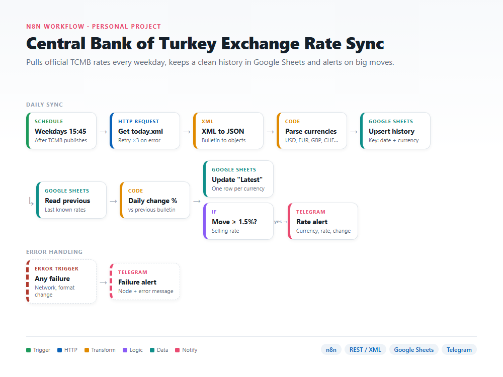
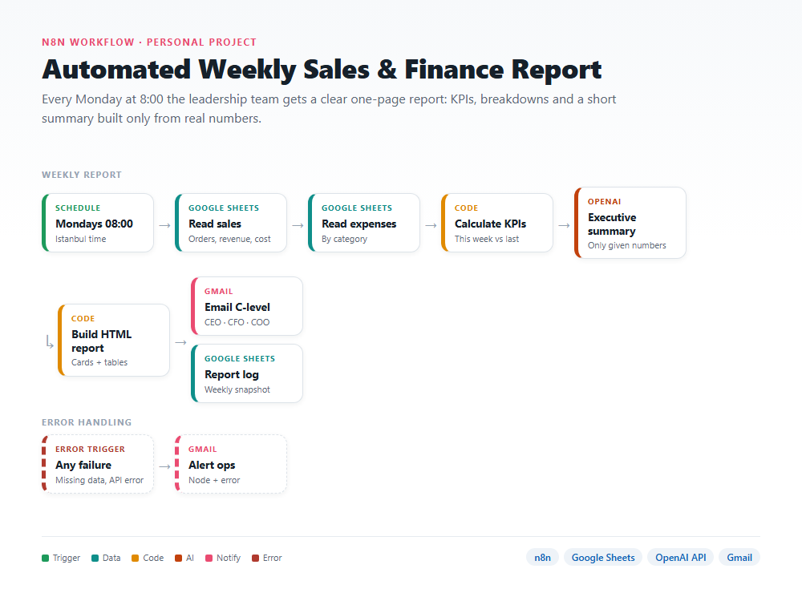
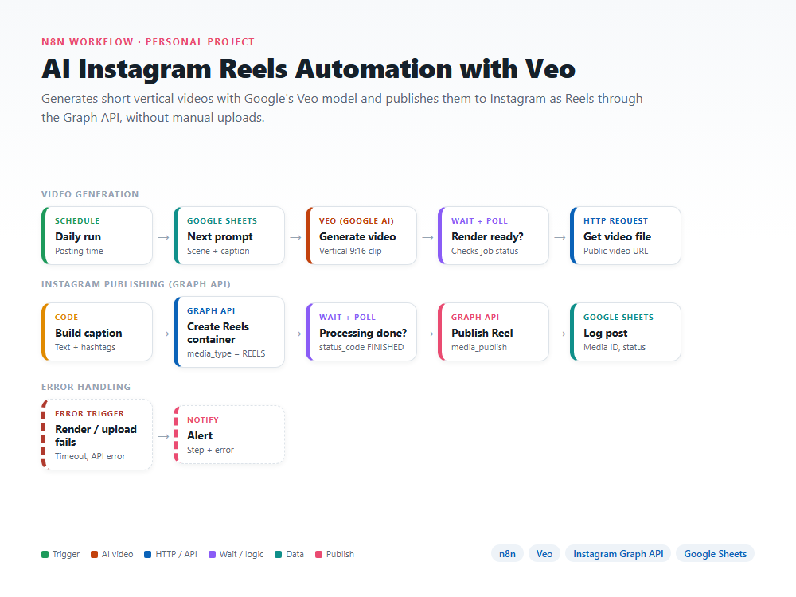

# n8n workflows

Some n8n automations I built for my own use and practice. The JSON files can be imported into n8n with Import from File.

## 1. TCMB exchange rates to Google Sheets

`1-tcmb-doviz-kuru-senkronizasyonu.json`

Runs on weekdays after the Central Bank publishes rates. It saves the rates to a sheet without duplicates and sends me a Telegram message if a currency moves more than 1.5%.

## 2. Stock trade tracker

`2-borsa-trade-takibi.json`

I send trades to a Telegram bot like `/buy AAPL 10 182.5` and they go into a sheet. After market close it calculates positions with average cost, gets prices and sends a daily P/L summary. It only tracks, it doesn't trade.

## 3. Weekly sales and finance report

`3-satis-finans-raporu-c-level.json`

Every Monday morning it reads the sales and expenses sheets, calculates the weekly numbers, adds a short summary with OpenAI and emails an HTML report to management.

## 4. Instagram Reels with Veo

Generates short vertical videos with Google Veo and posts them as Reels through the Instagram Graph API. Details in the [PDF](pdf/4-AI-Instagram-Reels-Automation.pdf).

## Notes

- You need your own Google Sheet, Telegram bot, Gmail and OpenAI credentials.
- Change `YOUR_TELEGRAM_CHAT_ID` and the example emails before running.
- Stock prices come from Yahoo Finance's public endpoint, it's not an official API.
- More detail for each one is in the `pdf` folder.
