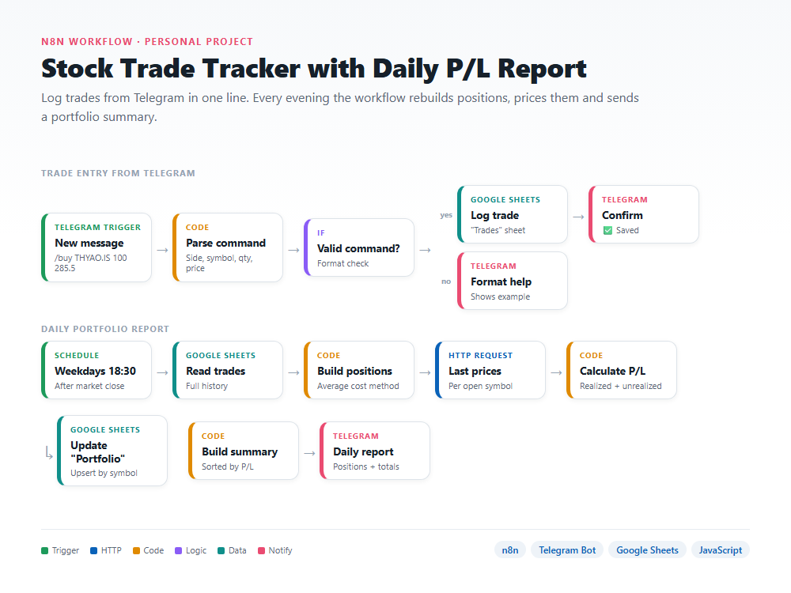

# n8n Automation Portfolio

n8n automation projects built as personal projects. The three JSON workflows can be imported directly into n8n (Workflows → ⋯ → Import from File); the Reels automation is documented as a case study.

| Workflow | What it does | File |
|---|---|---|
| **Central Bank of Turkey Exchange Rate Sync** | Pulls official TCMB rates every weekday, keeps a duplicate-free history in Google Sheets and sends a Telegram alert when a rate moves more than 1.5%. | [`1-tcmb-doviz-kuru-senkronizasyonu.json`](1-tcmb-doviz-kuru-senkronizasyonu.json) |
| **Stock Trade Tracker with Daily P/L Report** | Logs trades from Telegram with a one-line command, rebuilds positions with average cost after market close, prices them and sends a daily portfolio summary. Tracking only. | [`2-borsa-trade-takibi.json`](2-borsa-trade-takibi.json) |
| **Automated Weekly Sales & Finance Report** | Every Monday reads sales and expenses, calculates KPIs, adds a short AI summary based only on the real numbers and emails an HTML report to the CEO, CFO and COO. | [`3-satis-finans-raporu-c-level.json`](3-satis-finans-raporu-c-level.json) |
| **AI Instagram Reels Automation with Veo** | Generates vertical videos with Google's Veo model and publishes them as Instagram Reels through the Graph API (container → processing check → publish → log). | [Case study (PDF)](pdf/4-AI-Instagram-Reels-Automation.pdf) |

## Diagrams

### AI Instagram Reels Automation

### Exchange Rate Sync

### Stock Trade Tracker

### Weekly C-Level Report

Case studies (PDF): [Exchange Rate Sync](pdf/1-TCMB-Exchange-Rate-Sync.pdf) · [Stock Trade Tracker](pdf/2-Stock-Trade-Tracker.pdf) · [Weekly Report](pdf/3-Weekly-CLevel-Report.pdf)

## Setup notes

- Google Sheets nodes need your own spreadsheet. Sheet names used: `Rate History`, `Latest` · `Trades`, `Portfolio` · `Sales`, `Expenses`, `Report Log`.
- Credentials needed: Google Sheets, Telegram Bot, Gmail and OpenAI (report workflow only).
- Replace `YOUR_TELEGRAM_CHAT_ID` and the example email addresses before running.
- Stock prices come from a public Yahoo Finance endpoint, which is not an official API.

## Stack

n8n · JavaScript (Code nodes) · REST / XML · Google Sheets · Telegram Bot API · Gmail · OpenAI API
